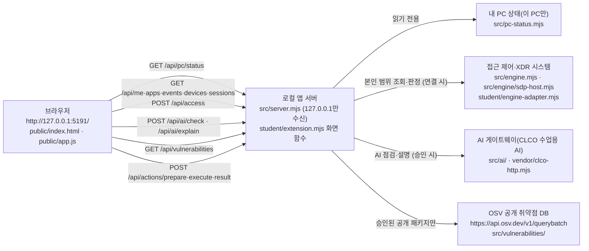

# InSecret 학생 실행 설명서와 구성도

이 문서는 학생이 새로 작성한 문서입니다. 제공 문서(`README.md`, `docs/` 아래 학생 문서 두 개를 뺀 나머지)는 고치지 않았습니다.

- 보안 Agent 이름: **InSecret** (앱 화면 제목은 시작 틀 기본값인 **케셰브**를 그대로 씁니다)
- 시작 틀 버전: `package.json`의 `"version": "0.2.21"` (2026-10-30에 0.2.11에서 갱신. 제공 파일만 바뀌었고 학생 파일은 보존)
- 학생 작성 파일(6장의 목록과 같음): `on-client/student/extension.mjs`(13~20단계 코드), `on-client/docs/STUDENT_RUNBOOK.md`(21단계, 이 문서), `on-client/docs/STUDENT_RELEASE_RECORD.md`(22단계 재현·릴리스 기록)

표기 규칙: **[확인]** 은 이 PC에서 실제로 실행·화면 확인한 것, **[코드]** 는 코드·스크립트만 읽은 것, **[미확인]** 은 아직 확인하지 못한 것입니다.

---

## 1. 목적과 기능

회사 직원이 자기 로그인 상태, 업무 앱 접속 판정, 최근 접속·XDR 기록과 보안 경보, 설치 패키지의 알려진 취약점을 한 화면에서 확인하는 보안 앱입니다. 확인되지 않은 연결·결과를 성공처럼 보여 주지 않는 것을 원칙으로 합니다.

| 메뉴(탭) | 학생 칸 | 보여 주는 것 |
|---|---|---|
| 보호 현황 | `renderIdentity`, `renderStatus`, `renderAiConnection`, `renderVulnerabilities` | 로그인·기기·세션, 연결 점검, AI 연결 상태, 설치 패키지 OSV 조회 |
| 업무 앱 | `renderDecision` | 업무 앱 접속 판정과 이유 |
| 보안 기록 | `renderEvents`, `renderExplanation`, `renderAction` | 접속·XDR 기록, AI 설명, 보안 조치 상태 |

0.2.21의 보호 현황에는 제공 카드 「내 PC 상태」(「내 PC 확인」 버튼, 「10초마다 확인」 선택)가 추가됐습니다. 학생 함수가 아니라 제공 기능입니다. [확인] 카드와 "아직 조회하지 않았습니다" 표시 / [미확인] 「내 PC 확인」 조회 결과

---

## 2. 지원 환경과 버전

| 항목 | 값 | 근거 |
|---|---|---|
| 운영체제 | Windows 11 Pro | [확인] 이 PC |
| Node.js | `v24.19.0` | [확인] `node --version` 결과. `package.json`의 `engines.node`도 `24.19.0` |
| Node.js 허용 범위 | 22~24 (24.19.0 권장) | [코드] `tools/start-alekov.ps1` 버전 검사 |
| 외부 npm 의존성 | 없음 (`npm install` 불필요, lock 파일 없음) | [코드] `package.json`에 dependencies 없음 |
| 셸 | Windows PowerShell | [확인] |
| 브라우저 | PC의 Chrome | [확인] |

지원하지 않거나 확인하지 않은 환경: macOS·Linux, Node.js 21 이하·25 이상, 휴대폰 브라우저는 [미확인]입니다.

---

## 3. 폴더 구조

```
4차 방어전\                       ← Git 최상위 폴더 (origin: https://github.com/whoisinsu/4th-shield)
└─ on-client\                     ← 앱 폴더. PowerShell은 여기서 엽니다
   ├─ package.json                ← 이름 alekov-client-starter, 버전 0.2.11, npm 스크립트
   ├─ .env.example                ← 비밀 없는 설정 견본 (실제 .env를 만들면 커밋하지 않음)
   ├─ tools\start-alekov.ps1      ← 실행 도구 (제공)
   ├─ src\server.mjs              ← 로컬 앱 서버 (제공)
   ├─ src\engine.mjs, src\engine\ ← 접근 제어·XDR 시스템 연결 (제공)
   ├─ src\ai\, vendor\clco-http.mjs ← AI 게이트웨이 연결 (제공)
   ├─ src\vulnerabilities\        ← package-lock 대조·OSV 조회 (제공)
   ├─ src\actions\                ← 보안 조치 준비·집행·결과 조회 (제공)
   ├─ src\pc-status.mjs           ← 내 PC 상태 읽기 (제공, 0.2.21)
   ├─ src\student-appearance*.mjs ← 학생 꾸밈 파일 읽기 (제공, 0.2.21. 마무리 단계용)
   ├─ tools\package-app.mjs       ← 설치형 앱 포장 (제공, 0.2.21. 22단계 뒤 마무리 단계용)
   ├─ public\index.html, app.js   ← 화면과 제공 UI (제공)
   ├─ student\extension.mjs       ← 학생 작성 화면 함수 (학생)
   ├─ docs\STUDENT_RUNBOOK.md     ← 이 문서 (학생, 21단계)
   └─ docs\STUDENT_RELEASE_RECORD.md ← 새 환경 재현·릴리스 기록 (학생, 22단계)
```

이 PC의 실제 위치: `C:\Users\Administrator\AppData\Local\ALEPH\Workbench\projects\4차 방어전\on-client` [확인]

---

## 4. 실행 절차

### 4-1. PowerShell을 여는 위치
1. 파일 탐색기에서 `on-client` 폴더를 엽니다.
2. 주소 표시줄에 `powershell`을 입력하고 Enter를 누릅니다. 또는 새 PowerShell 창에서 아래처럼 이동합니다. 아래 경로는 이 PC의 예시이며, 다른 PC·새 폴더에서는 저장소를 받은 위치의 `on-client`로 바꿉니다(새 환경 재현 기록: `docs/STUDENT_RELEASE_RECORD.md`).
```powershell
cd "C:\Users\Administrator\AppData\Local\ALEPH\Workbench\projects\4차 방어전\on-client"
```
3. Node.js 버전을 확인합니다.
```powershell
node --version
```
정상: `v24.19.0` [확인]

### 4-2. 실행 명령

| 목적 | 명령 (on-client 폴더에서) | 브라우저 주소 | 근거 |
|---|---|---|---|
| 예제 자료 화면 | `powershell -NoProfile -ExecutionPolicy Bypass -File .\tools\start-alekov.ps1 -Demo -Port 5191` | http://127.0.0.1:5191/ | [확인] 0.2.21에서 새 PowerShell 창으로 실행해 화면 확인 |
| 연결 기능 없이 로컬 확인 | `powershell -NoProfile -ExecutionPolicy Bypass -File .\tools\start-alekov.ps1 -NoNativeHost -Port 5190` | http://127.0.0.1:5190/ | [코드] 0.2.21에 추가된 옵션 |
| 기본 실행(계정 연결 준비 자동) | `powershell -NoProfile -ExecutionPolicy Bypass -File .\tools\start-alekov.ps1 -Port 5190` | http://127.0.0.1:5190/ | [미확인] 0.2.21부터 동작이 바뀜(아래 참고). 0.2.11에서는 "연결 없음"으로 확인 |
| 기본 포트(5189) | `powershell -NoProfile -ExecutionPolicy Bypass -File .\tools\start-alekov.ps1` | http://127.0.0.1:5189/ | [코드] 스크립트 기본값 5189 |
| 문법 검사 | `npm run check` (= `node --check student/extension.mjs`) | – | [확인] `node --check`로 실행 |
| npm으로 실행 | `npm start` / `npm run demo` | http://127.0.0.1:5189/ | [미확인] |
| 담당자 설정 연결 | `-NativeHostConfig <절대경로>`, `-SdpHostConfig <절대경로>` | – | [미확인] 담당자 설정 파일이 없어 실행하지 않음 |

- `-ExecutionPolicy Bypass`는 이 한 번의 실행에만 적용되며 컴퓨터 설정을 바꾸지 않습니다. [코드]
- `-Demo`는 예제 자료이며 실제 연결이나 성취가 아닙니다. 화면에 "예제 자료 · 실제 연결 아님"이 표시됩니다. [확인]
- 0.2.21의 기본 실행(`-Demo`·`-NoNativeHost` 없이)은 시작 전에 계정 연결용 개인 설정을 사용자 폴더의 `.aleph-keshev-<프로젝트 경로 해시>\native.json`에 자동으로 준비하고 "계정 연결 준비가 끝났습니다. 앱에서 확인 번호로 로그인·승인을 진행하세요."를 출력합니다. 이 준비만으로 로그인·AI 연결이 끝나지 않습니다. [코드] `tools/start-alekov.ps1`, `docs/STUDENT_LAUNCH_GUIDE.md`
- `-Demo`는 이 자동 준비를 하지 않습니다. [코드]

### 4-3. 정상 시작 신호
PowerShell 창에 아래 문구가 나오면 서버가 응답한 것입니다. [코드] `tools/start-alekov.ps1`의 출력 문구 (주소의 포트 번호는 실행 명령에 따라 바뀝니다)
```
케셰브가 켜졌습니다. 브라우저에서 http://127.0.0.1:5191/ 을 여세요.
서버가 응답한 것만 확인했습니다. AI 연결 상태는 화면에서 따로 확인해 주세요.
끄려면 이 창에서 Ctrl+C 를 누르세요.
```
이 문구는 서버 응답만 뜻하며 AI·회사 시스템 연결 성공을 뜻하지 않습니다.

### 4-4. 종료와 재실행
1. 종료: 서버를 켠 PowerShell 창에서 **Ctrl+C**를 누릅니다. [코드] 스크립트 안내 문구
2. 재실행: 같은 창에서 4-2의 명령을 다시 실행합니다.
3. 브라우저는 **Ctrl+F5**로 새로고침합니다. [확인]
4. `-Background`로 켠 경우 표시된 프로세스 번호의 node를 작업 관리자에서 종료합니다. [코드]

---

## 5. 구성도



같은 내용을 글로 적은 표입니다.

| 상자 | 실제 파일·주소 | 역할 | 이 PC 상태 |
|---|---|---|---|
| 브라우저 | `http://127.0.0.1:5191/`, `public/index.html`, `public/app.js` | 화면, 버튼, 요청 세대·취소 관리 | [확인] 응답함 |
| 로컬 앱 서버 | `src/server.mjs` (`127.0.0.1:<포트>`만 수신, 다른 Host·cross-site 요청 거절) | API 제공, 비밀값 보관, 학생 모듈에는 본인 범위 기능만 전달 | [확인] 응답함 |
| 학생 화면 함수 | `student/extension.mjs` | 받은 상태를 글자·class로 그림. 요청·집행 없음 | [확인] |
| 접근 제어·XDR 시스템 | `src/engine.mjs`, `src/engine/sdp-host.mjs`, `src/engine/trusted-app-assembly.mjs`, `student/engine-adapter.mjs` | 로그인·기기·세션·기록·판정 원천 | [미확인] 설정 없음 → "연결 없음" |
| 내 PC 상태 | `/api/pc/status`, `src/pc-status.mjs`, `public/pc-status-view.mjs` | 이 PC의 CPU·메모리·디스크 등 읽기 전용 조회(제공) | [확인] 카드 표시 / [미확인] 조회 결과 |
| AI 게이트웨이 | `src/ai/`, `vendor/clco-http.mjs` | AI 연결 점검과 사건 설명 | [미확인] 권한 준비 중 |
| OSV | `https://api.osv.dev/v1/querybatch`, `src/vulnerabilities/` | 설치 버전의 알려진 취약점 조회 | [미확인] 조회 대상 설정 없음 → not_configured |

비밀값(열쇠·토큰·비밀번호)과 담당자 설정 파일 내용은 이 문서와 저장소에 넣지 않습니다. 설정 이름 견본은 `.env.example`에만 있습니다: `ON_PORT`, `ON_ENGINE_ADAPTER`, `ON_AI_MODEL`, `ON_PROJECT_DIRECTORY`, `ON_APPROVED_PUBLIC_PACKAGES`.

---

## 6. 제공 코드와 학생 작성 부분

제공/학생 구분 기준은 `on-client/.on-starter-manifest.json`과 Git 기록입니다.

| 구분 | 파일 | 단계 |
|---|---|---|
| 학생 작성 | `student/extension.mjs` | 13~20 (8개 화면 함수) |
| 학생 작성 | `docs/STUDENT_RUNBOOK.md` (이 문서) | 21 |
| 학생 작성 | `docs/STUDENT_RELEASE_RECORD.md` | 22 |
| 제공 | 위 세 파일을 뺀 `on-client` 아래 모든 파일(`student/engine-adapter.mjs` 포함). 시작 틀 0.2.21 갱신 커밋(7511996)은 학생이 저장했지만 내용은 제공 파일 그대로이며 학생 파일을 포함하지 않음 | – |

학생 작성 파일 목록은 `docs/STUDENT_RELEASE_RECORD.md` 1장과 같습니다. 서버·`public/app.js`·판정 코드·인증 설정은 고치지 않았습니다.

| 단계 | 학생 함수 | 보여 주는 것 | 제공 코드가 맡는 부분 |
|---|---|---|---|
| 13 | `renderIdentity` | 사용자·현재 기기·세션과 보안 상태를 글자로 표시, 기기·세션 목록, 연결 모드 | `/api/me·devices·sessions` 조회 |
| 14 | `renderDecision` | 업무 앱 접속 판정(allow·deny·challenge·unknown)과 서버가 준 이유. 요청 실패는 거부 판정과 구분 | `/api/access` 판정 요청 |
| 15 | `renderEvents` | 본인 접속·XDR 기록 목록, 필터, 빈 결과·오류 구분 | `/api/events` 조회 |
| 16 | `renderStatus` | 기기·세션·알림·연결 점검 상태, 도움정보 6개 값 복사 버튼 | `/api/diagnostics` 조회 |
| 17 | `renderAiConnection` | 모델 응답 점검과 실제 사건 설명 구분, AI 오류·취소 안내 | AI 연결·승인·점검 요청 |
| 18 | `renderExplanation` | 선택한 사건의 근거·규칙·현재 상태와 AI 설명. 제안은 자동 실행하지 않음 | `/api/ai/explain` 요청 |
| 19 | `renderAction` | 조치 상태 idle~error 구분, ACK와 실제 효과 구분, 결과 불명 처리 | 조치 준비·집행·재조회 버튼과 요청 |
| 20 | `renderVulnerabilities` | 전체 조회 상태 5가지, lock 값, 패키지별 정확한 버전·취약점 ID | 조회·취소 버튼, 응답 검증, OSV 조회 |

---

## 7. 장애별 확인·복구 순서

화면이나 PowerShell에 실제로 나오는 문구 기준입니다.

| 화면 문구·코드 | 위치 | 원인 | 확인·복구 | 근거 |
|---|---|---|---|---|
| `앱 폴더가 아닙니다…` | PowerShell | `on-client`가 아닌 곳에서 실행 | 4-1처럼 `on-client`로 이동 후 재실행 | [코드] |
| `Node.js 가 없습니다…` / `앱은 Node.js 22~24 에서 실행합니다` | PowerShell | Node.js 없음·범위 밖 | Node.js 24.19.0 설치 후 새 창에서 재실행 | [코드] |
| `포트 5191 를 다른 프로그램이 쓰고 있습니다…` | PowerShell | 이미 서버가 켜져 있음 | 기존 창에서 Ctrl+C로 끄거나 `-Port` 번호를 바꿈. 다른 프로그램을 강제로 끄지 않음 | [코드] |
| `앱 서버가 20 초 안에 뜨지 않았습니다…` | PowerShell | 서버 시작 실패 | 창의 메시지를 담당 강사에게 전달 | [코드] |
| `연결 모드: 연결 없음` | 학생 칸 | 회사 시스템 설정 없이 기본 실행 | 정상. 연결은 담당자 설정 후에만 가능 | [확인] |
| `예제 자료 · 실제 연결 아님` | 학생 칸 | `-Demo` 실행 | 정상. 실제 결과로 쓰지 않음 | [확인] |
| `NATIVE_HOST_DISABLED` (호스트 로그인 연결을 먼저 준비하세요) | 계정 연결 | 계정 연결 설정 없이 실행(0.2.11 기본 실행, `-NoNativeHost`) | 0.2.21은 기본 실행이 설정을 자동 준비함. 연결이 필요하면 `-NoNativeHost` 없이 다시 실행 | [확인] 0.2.11 / [미확인] 0.2.21 |
| `계정 연결 설정을 준비하지 못했습니다…` | PowerShell | 자동 준비 실패 | 출력된 코드를 담당자에게 전달. 학생 작업은 그대로 보존됨 | [코드] |
| `ON_AI_PROVISIONING_PENDING` (학생 앱 이용 권한의 발급·연결을 준비 중입니다) | AI 연결 | AI 이용 권한 미발급 | 담당자에게 확인. 유료 요청을 반복하지 않음 | [확인] |
| `조회 준비 미완료(not_configured)` · `PROJECT_NOT_CONFIGURED` | 패키지 조회 | 조회 대상 프로젝트 설정 없음 | 정상 미조회 상태. 담당자가 대상 경로를 준비. "취약점 없음"이 아님 | [확인] |
| `아직 조회 안 함(not_checked)` | 패키지 조회 | 승인된 공개 패키지 없음 | 담당자가 허용 목록 준비. "취약점 없음"이 아님 | [코드] |
| `조회 실패` / `조회 취소` | 패키지 조회 | 시간 초과·서버 오류·취소 | 「설치 패키지 조회」를 직접 다시 누름. 이전 결과를 현재 결과로 보지 않음 | [코드]·모의 |
| `확인 불가` (`CONTRACT_MISMATCH` 등) | 각 학생 칸 | 응답 형식을 확인할 수 없음 | 「다시 불러오기」 후에도 같으면 도움정보를 담당자에게 전달 | [코드] |
| `결과 불명(unknown)` | 조치 상태 | 효과 관측 없음·접수 정보 불일치 | 「원천 결과만 재조회」를 누름. 다시 집행하지 않음 | [코드]·모의 |

자세한 오류 코드는 제공 문서 `docs/CONNECTION_TROUBLESHOOT.md`를 함께 봅니다.

---

## 8. 확인한 기능과 기다림(UNV) 목록

### 확인한 기능
| 기능 | 확인 방법 |
|---|---|
| 0.2.21 예제 모드(5191) 시작, 예제 자료 표시, 학생 칸 표시 | [확인] 새 PowerShell 창·브라우저 |
| 0.2.11 기본 실행(5190) "연결 없음" 표시 | [확인] 갱신 전 |
| 13~16단계 학생 칸 표시(예제 자료), 다시 불러오기 시 이전 값 미잔존 | [확인] 화면 |
| 17단계 AI 연결 칸 상태 표시 | [확인] 화면(권한 준비 중) |
| 19단계 조치 상태 idle 표시, 다시 불러오기 후 idle 유지 | [확인] 화면 |
| 20단계 not_configured 표시, 다시 조회 시 새 요청·새 조회 시각 | [확인] 화면·Network 탭 |
| 각 단계의 상태별 표시 | 모의 입력 점검(Node 스크립트) |

### 기다림(UNV) — 아직 실제로 확인하지 못한 것
| 기능 | 이유 |
|---|---|
| 실제 계정 연결(native 로그인) | `NATIVE_HOST_DISABLED`, 담당자 설정 필요 |
| 실제 접근 제어·XDR 시스템 조회·판정 | 연결 설정 없음 |
| 실제 AI 연결 점검·사건 설명 | `ON_AI_PROVISIONING_PENDING` |
| 보안 조치 준비·집행·효과 확인 | 지원 조치 없음, 시험 집행 금지 |
| OSV 패키지 행·취약점 결과 표시 | 조회 대상 설정 없음 |
| 패키지 조회 취소 후 늦은 응답 차단 | 응답이 빨라 화면에서 재현 못 함 |
| `npm start`·`npm run demo`·`-Background`·기본 포트 5189 실행 | 실행하지 않음 |
| 0.2.21 기본 실행의 계정 연결 자동 준비, `-NoNativeHost` 실행 | 갱신 뒤 실행하지 않음 |
| 「내 PC 상태」의 「내 PC 확인」 조회 결과 | 카드 표시만 확인하고 조회는 누르지 않음 |
| `npm run package-app`(설치형 앱 포장)·학생 꾸밈 | 22단계 뒤 마무리 단계 범위. 실행하지 않음 |

OSV는 알려진 취약점 데이터베이스입니다. 조회 결과가 없다는 사실만으로 패키지나 앱 전체가 안전하다고 보장할 수 없습니다.
